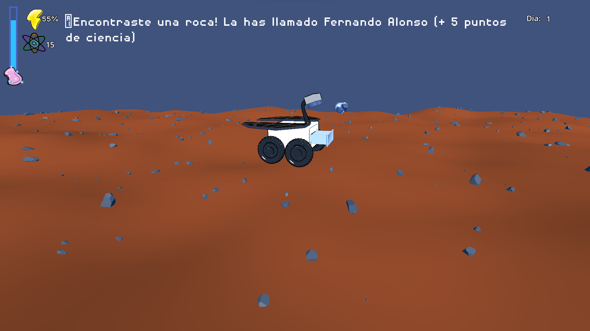

import { YouTube } from "astro-embed";

After Dark: Mars Mission is a resource-management card game where you guide Roberto the Rover across Mars. We made it for the Indie Spain Jam 2023: I worked on it as a developer and also composed its soundtrack. You can play it in the browser on itch.io.

## How it plays

- **The mission.** You guide Roberto the Rover across the Martian landscape and try to survive its harsh environment.
- **Cards and energy.** Actions are cards, like Explore, and each one costs energy, so you have to manage what you have left.
- **Secrets.** Along the way you discover lots of secrets (rocks). Every rock has a name, and finding one earns science points.

## The animation

J. Ricardo made an animated short for the game:

<YouTube
  id="JQpDgyDOAT0"
  title="After Dark: Mars Mission Animation by J. Ricardo"
  class="!max-w-full"
/>

## Play it

The game runs in the browser. I also wrote about composing its soundtrack.

  <a href="https://katpuccinox.itch.io/after-dark-mars-mission" target="_blank" rel="noopener noreferrer" class="btn btn-primary">Play on itch.io ↗</a>
  <a href="/portfolio/posts/music/after_dark/" class="btn btn-ghost">About the soundtrack →</a>

*Made with [Lucas Colbert Eastgate](https://www.linkedin.com/in/lucas-colbert-eastgate-140a911b3/), [Alba Sánchez Ibañez](https://www.linkedin.com/in/alba-s-093242259/) and [J. Ricardo Sánchez Ibáñez](https://www.linkedin.com/in/jricardosi/).*
