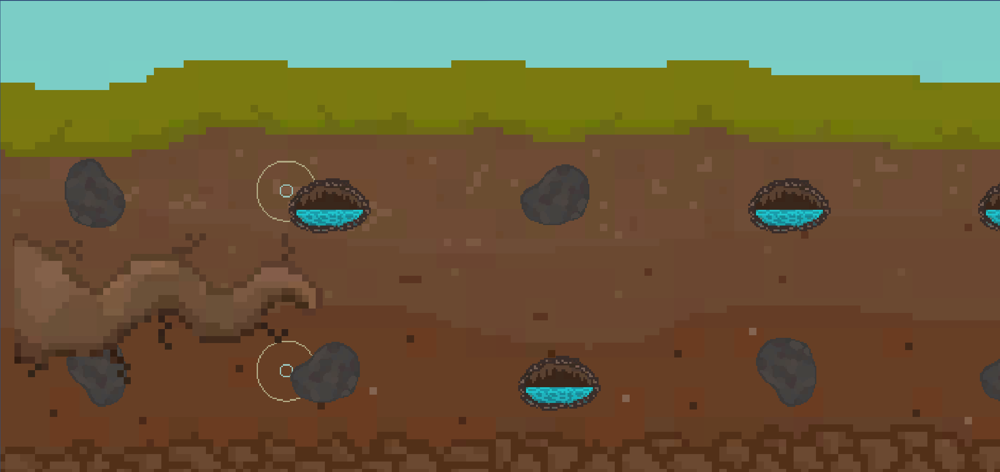

Symphony Root is a rhythm game where you play as the root of an apple tree, growing underground to find water while dodging rocks and other obstacles in time with the music. We made it for the Global Game Jam 2023, whose theme was "Roots".

## How it plays

- **The root.** You steer the root of an apple tree through the ground.
- **Water.** It needs water to grow, so you go after the pools along the way.
- **Obstacles.** Rocks and other obstacles block the path, and everything moves in sync with the music.

## The theme

The jam's theme was "Roots", and we took it literally, in a playful and musical way: the player is the root, and the soundtrack sets the rhythm of the game.

## Play it

You can download the game on itch.io, and the jam page has the original submission.

  <a href="https://deinigu.itch.io/symphony-root" target="_blank" rel="noopener noreferrer" class="btn btn-primary">Download on itch.io ↗</a>
  <a href="https://v3.globalgamejam.org/2023/games/symphony-root-8" target="_blank" rel="noopener noreferrer" class="btn btn-ghost">Global Game Jam page ↗</a>

*Made with [Lucas Colbert Eastgate](https://www.linkedin.com/in/lucas-colbert-eastgate-140a911b3/), [Daniel de Lizaur García](https://www.linkedin.com/in/delizaur/) and Guillermo Cervi Salmerón.*
