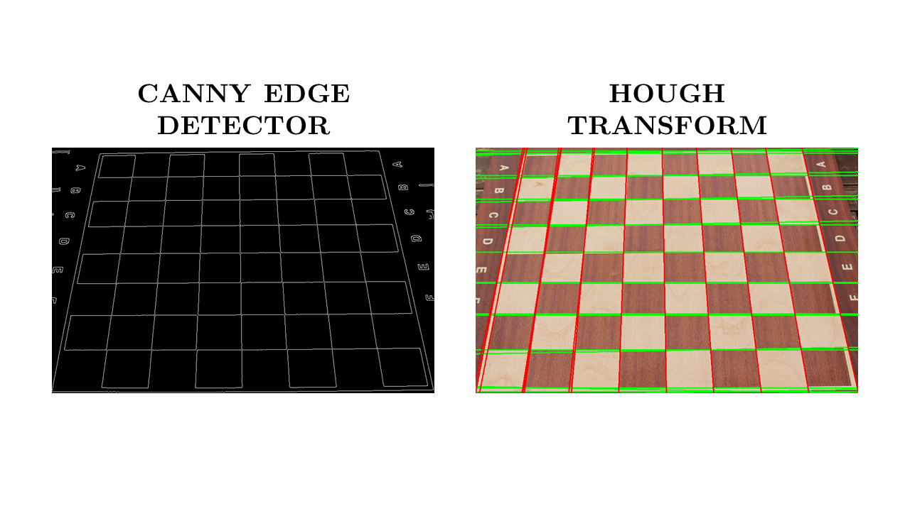
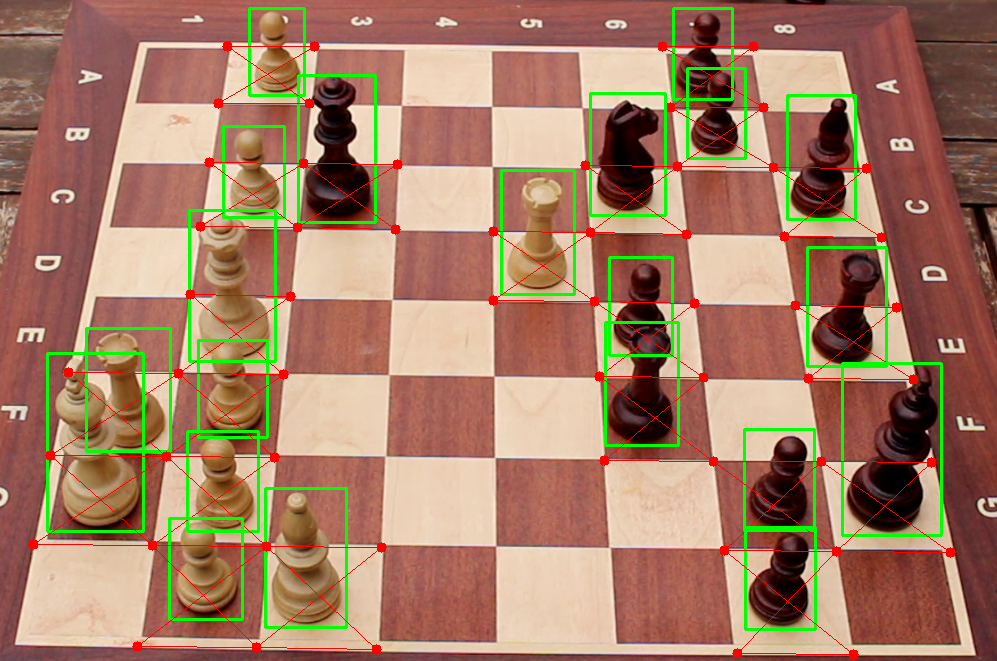
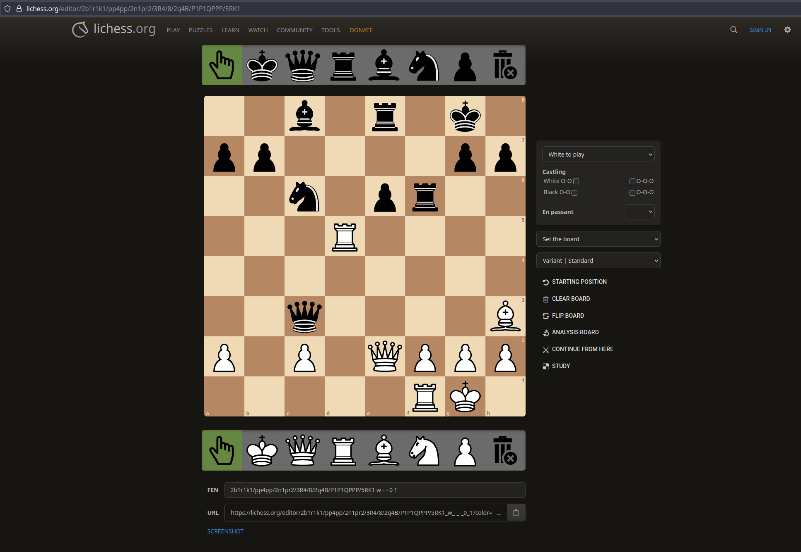

My final degree project at the University of Málaga: a system that takes a photo of a real chessboard, detects and classifies every piece with YOLOv8, finds the board with OpenCV, and outputs the position in FEN, ready to open in Lichess. The video shows the final version running.

<blockquote class="twitter-tweet" data-media-max-width="1080">
Final version executed! I&#39;m thrilled with how project turned out. ♟️ <a href="https://twitter.com/hashtag/Chess?src=hash&amp;ref_src=twsrc%5Etfw">#Chess</a> <a href="https://twitter.com/hashtag/AI?src=hash&amp;ref_src=twsrc%5Etfw">#AI</a> <a href="https://twitter.com/hashtag/YoloV8?src=hash&amp;ref_src=twsrc%5Etfw">#YoloV8</a> <a href="https://twitter.com/hashtag/OpenCV?src=hash&amp;ref_src=twsrc%5Etfw">#OpenCV</a> <a href="https://twitter.com/hashtag/SoftwareDevelopment?src=hash&amp;ref_src=twsrc%5Etfw">#SoftwareDevelopment</a> <a href="https://t.co/jp0VNBykG1">https://t.co/jp0VNBykG1</a> <a href="https://t.co/GgwBZJ79pB">pic.twitter.com/GgwBZJ79pB</a>
&mdash; Deinigu (@DeiniguDev) <a href="https://twitter.com/DeiniguDev/status/1820090248933625980?ref_src=twsrc%5Etfw">August 4, 2024</a></blockquote> 

## Why

I wanted to make it easy to digitize games played on a physical board, starting from a single photo. It's meant for chess players, streamers and digitizing tournaments.

## How it works

- **Dataset.** No public dataset fit what I needed, so I made one: 130 frames of a board in my yard, filmed with a Canon EOS 100D under changing natural light and labeled by hand in CVAT. 90 are for training, 30 for validation and 10 for testing only.
- **Piece detection.** A YOLOv8 model (Ultralytics) detects the pieces and classifies them into 12 classes, one per piece and colour. I trained it on Google Colab with an NVIDIA Tesla T4 and validated it with 5-fold cross-validation.
- **Board detection.** The photo is converted to grayscale and blurred, then Canny finds the edges and a Hough transform finds the lines. Their intersections are the corners of the cells, which are grouped into the 8×8 grid.
- **Position.** Each piece goes to the cell whose centre is nearest, and a column-shift step places any piece left over. The final board becomes a FEN string and a Lichess link.

## Finding the board

Detecting the board needed more than one try. OpenCV's `findChessboardCorners` only detected 6×6 boards, and Harris and Shi-Tomasi corner detection picked up noise from the edges around the board. Canny edge detection, with a threshold set automatically from the image, followed by a Hough transform is what worked.

## Results

For each photo, the system saves annotated images with the grid and the detected pieces, and prints the FEN and a Lichess link to the position:

## Code and details

The repository has the code, and the paper covers the dataset, the training and the evaluation in detail.

  <a href="https://github.com/Deinigu/TFG-Diego" target="_blank" rel="noopener noreferrer" class="btn btn-primary">Code on GitHub ↗</a>
  <a href="https://www.linkedin.com/posts/dlreduello_tfg-activity-7222631442877472768-mZHz" target="_blank" rel="noopener noreferrer" class="btn btn-ghost">Read the paper ↗</a>

