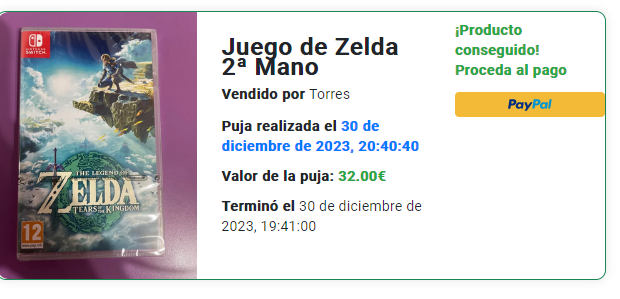

elRastro is an auction and e-commerce web app: people list products, bid on them and pay for the ones they win. We built it as a team for the final project of the Web Engineering course. Below, a won auction ready to be paid with PayPal.

## Why

It was the final project for the Web Engineering course. The goal was a complete application: microservices, cloud deployment, and integrations for sign-in, payments and maps.

## How it works

- **Microservices.** Separate services for users, products, bids, carbon footprint, conversations, ratings and images, built with Django and Django REST Framework on MongoDB Atlas and deployed on AWS EC2. They talk to each other through REST APIs.
- **Frontend.** Angular 17 and TypeScript, deployed on Vercel.
- **Sign-in and payments.** Google OAuth 2.0 for registration and login, and PayPal (ngx-paypal) to pay for winning bids.
- **Map.** Leaflet and OpenStreetMap show where each product is.
- **Messaging.** Users can talk to each other in conversations.
- **Other services.** Cloudinary, TimeZoneDB and FreecurrencyAPI.

## Products that relist themselves

When an auction closes without any bids, the product doesn't just disappear. It's put up again automatically with a 10 % discount and a closing date one week later.

## Code and details

The frontend and the backend each have their own repository.

  <a href="https://github.com/Deinigu/elRastro-fe" target="_blank" rel="noopener noreferrer" class="btn btn-primary">Frontend on GitHub ↗</a>
  <a href="https://github.com/Deinigu/elRastro-be" target="_blank" rel="noopener noreferrer" class="btn btn-ghost">Backend on GitHub ↗</a>

*Built with [Lucas Colbert Eastgate](https://www.linkedin.com/in/lucas-colbert-eastgate-140a911b3/), [Alba Sánchez Ibañez](https://www.linkedin.com/in/alba-s-093242259/), [Miguel Moya Castillo](https://www.linkedin.com/in/miguel-moya-castillo-07a0a7303/) and [Fernando Calvo Díaz](https://www.linkedin.com/in/fernando-calvo-d%C3%ADaz-8808a1268/).*
