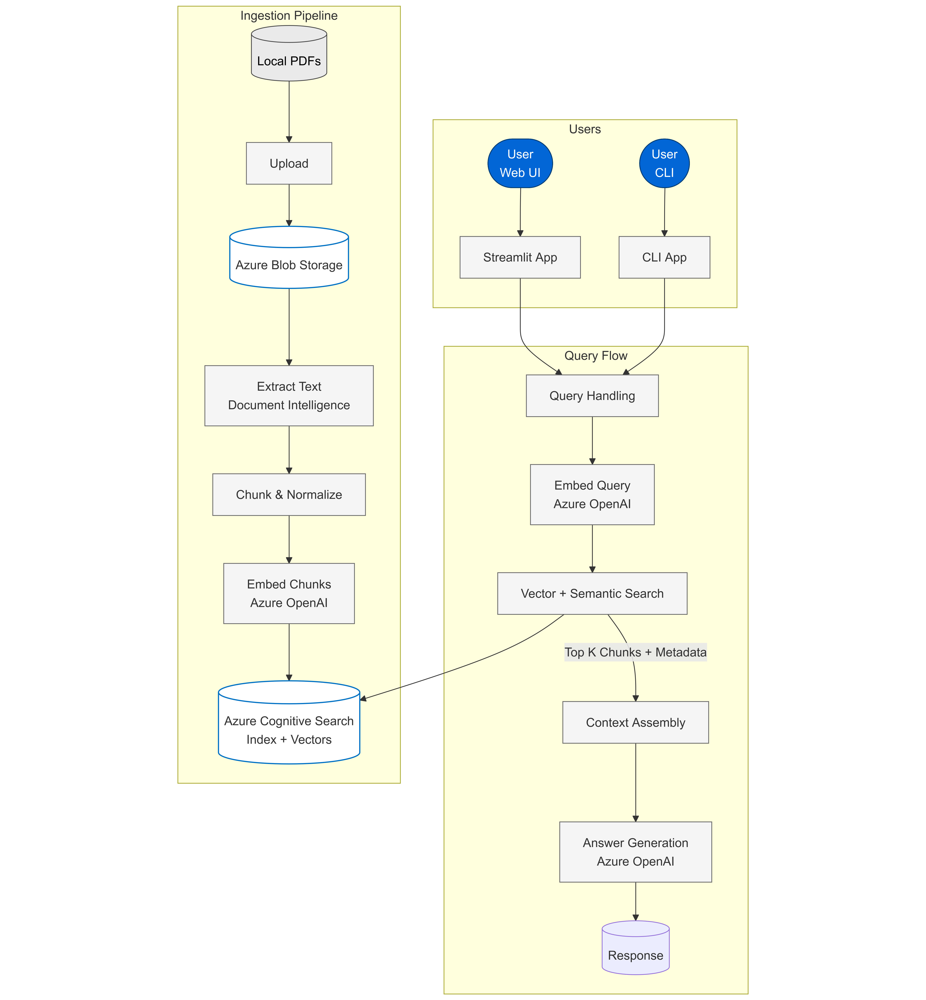

A Retrieval-Augmented Generation (RAG) system that answers questions about video game manuals and guides, using the documents themselves as its source. It runs on Azure OpenAI and Azure Cognitive Search, with a web chat and a console interface. The diagram shows how the pieces fit together.

## Why

The idea was to ask questions about video game manuals and guides in plain language and get answers based on the documents, not on what a language model happens to remember. Retrieval-augmented generation does that: it finds the relevant passages first, then writes the answer from them.

## How it works

- **Document processing.** Azure Document Intelligence extracts the text from the PDFs, which are stored in Azure Blob Storage. An MD5 hash check skips documents that haven't changed.
- **Search.** Azure Cognitive Search indexes the text with embeddings and finds relevant passages with vector and semantic search.
- **Answers.** Azure OpenAI GPT-4o-mini writes the answer from the passages it gets back.
- **Interfaces.** A Streamlit web chat with conversation history, chat statistics and export, plus a command-line interface for quick questions.
- **Configuration.** Everything is configured through environment variables, with no secrets in the code.

## Code and details

The repository has the code.

  <a href="https://github.com/Deinigu/videogame-assist-rag/" target="_blank" rel="noopener noreferrer" class="btn btn-primary">Code on GitHub ↗</a>

